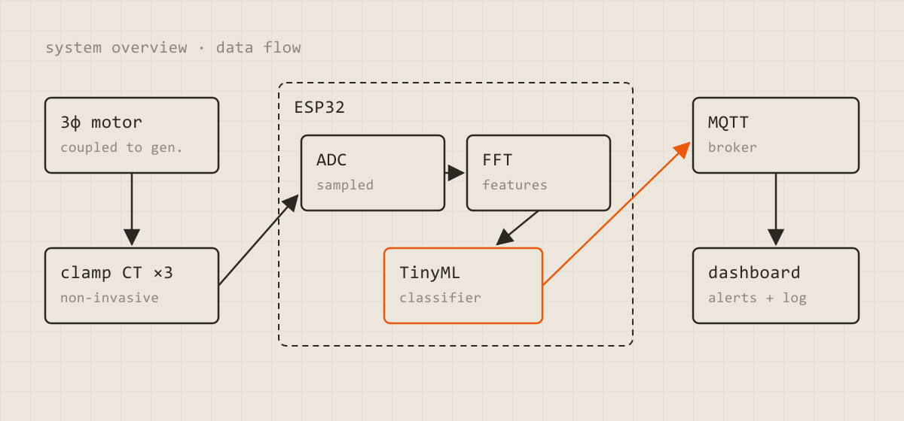

<!-- PLACEHOLDER: numbers in "Results" are illustrative. Replace with real thesis results. -->

## Summary

Induction motors drive most of the machines in a factory, and when one fails without warning the whole line stops. This project, my undergraduate thesis, asks a narrow question: can a cheap, clip-on sensor and a small model running on an ESP32 flag a developing fault early enough to schedule a repair instead of reacting to a breakdown?

The approach is **motor current signature analysis (MCSA)**. Faults such as broken rotor bars leave small, predictable "sidebands" in the current spectrum around the supply frequency. I measure current non-invasively, extract spectral features on the device, and classify the motor's condition with a TinyML model, publishing only the result over MQTT.

## Role & Context

I’m doing this alone as my thesis at Universitas Pendidikan Indonesia, supervised by two lecturers, using a motor–generator test bench in the faculty’s electrical machines lab. That means I own every layer: the sensing hardware, the signal processing, the model, and the small dashboard that shows the output.

The constraint that shapes everything is cost. The target user is a small workshop that can’t afford a commercial condition-monitoring system, so the bill of materials has to stay under the price of a single service visit.

## Problem

Most published MCSA work reports excellent accuracy, but almost always on a motor running at one or two fixed load levels. Real motors don’t behave like that. Load changes shift the slip, the slip moves the sidebands, and a model that memorized one operating point quietly falls apart at another.

So the real problem isn’t "can we classify faults", it’s:

- Can the features stay stable when the load changes?
- Can the whole pipeline (sampling, FFT, inference) fit in the memory and time budget of an ESP32?
- Can it fail honestly, and say "I’m not sure" instead of confidently mislabeling a load it has never seen?

## Approach & Technical Decisions

*Data flow. Raw current never leaves the device. Only the classification and a confidence score do.*

**Prove the pipeline on open data first.** Before touching the lab motor I rebuilt the full pipeline in Python on a public bearing-and-rotor dataset. This "phase 0" was cheap insurance: if the method couldn’t work on clean data, there was no point wiring anything.

**Normalize features by slip, not by frequency.** Instead of feeding raw FFT bins to the model, I locate the supply peak, estimate slip, and express each feature as a distance from where the fault sidebands *should* be for that slip. This was the single biggest improvement for robustness across loads.

**Clamp-on CTs instead of inline sensors.** Split-core current transformers clip around the cable without touching the motor’s wiring. That made the lab safety review straightforward and matches how a workshop would actually install it.

**Keep the model boring.** A small dense network on a handful of engineered features beats a convolutional model on raw spectra when you only have kilobytes of RAM. It also makes it possible to explain *why* the model made a call, which matters for a thesis defense.

**Train across every load level, document the edges.** The model is trained on the full range of load the bench can produce. Anything outside that range is treated as a stated limitation rather than a hidden failure mode.

## Results

So far, from the open-dataset phase and early bench runs:

- Pipeline reproduces published results on the open dataset: **~96% accuracy** when train and test share the same load levels.
- The same model drops to **~70%** on unseen load levels. This confirmed the core problem and justified the slip-normalized features.
- With slip-normalized features, accuracy on unseen loads recovers to **~88%** in offline tests.
- Feature extraction and inference fit on the ESP32 in **under 40 ms** per one-second window, using about **60 KB** of RAM.

Next steps are collecting labeled data from the lab bench at several load levels and validating the on-device model end to end.

## Media & Links

The thesis repository is private until the defense. A short write-up of the phase 0 results and a demo video of the bench setup will be linked here once they’re ready.
